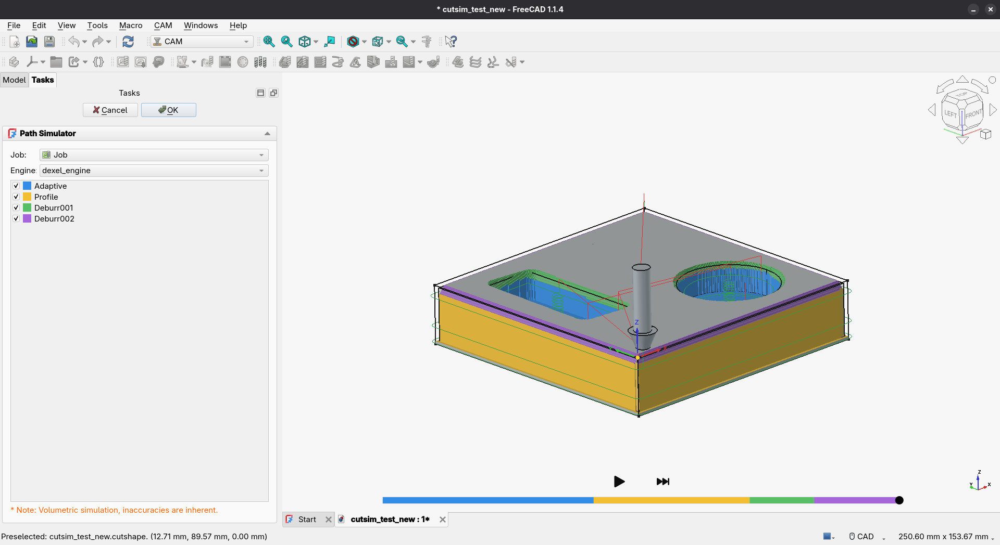
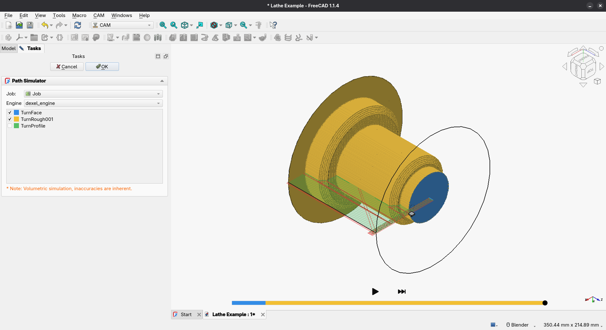

# FreeCAD Path Simulation
A FreeCAD CAM Addon to help simulate CNC tool paths.  

## Description
This addon appears under **CAM -> CAM Addons -> Path Simulator Next** in the CAM
workbench. Its purpose is to visualise and animate CNC tool paths prior to being
run on a machine.

## Features
* Display path job and operations
* Visulise tool paths
* Simulate material removal

## Screenshots

### Milling simulation


### Turning simulation


## Requirements
* FreeCAD with the CAM workbench (`CAMWorkbench`); the legacy Path workbench is not supported
* Python3  
* Qt5

## Installation
1. Use `git clone` or download the `.zip` file of this repo directly in to your [FreeCAD `Mod/` directory](https://www.freecadweb.org/wiki/Installing_more_workbenches).  
2. Restart FreeCAD 
3. Open a document with a CAM job and activate the CAM workbench.
4. Select **CAM -> CAM Addons -> Path Simulator Next**.
5. Select the operations and engine in the task panel, then use **Play** in the
   viewport timeline to start the simulation or **Pause** to pause it.
   **Jump to end** reconstructs the final stock without playing the remaining moves.

## Timeline seeking
Click the timeline or drag its marker to reconstruct the stock at that position.
The marker moves immediately; the stock and tool update when reconstruction is
finished, without displaying intermediate cuts. Seeking preserves the current
play/pause state. A new seek replaces any pending destination.

Backward seeks rebuild from the starting stock, so long paths can still take
time to reconstruct.

The dexel engine batches straight turning cuts within each motion command.
Playback follows tool-controller speeds. If cutting or mesh updates cannot keep
up, the preview slows down instead of jumping ahead through a pass. Timeline
positions, stock resolution and mesh generation are unchanged. Stock updates and
seeks include the exact partial move at the current sampled position.

## Tests
Run the headless worker regression checks (no FreeCAD installation required):

```sh
python3 -B -m unittest discover -s tests -v
```

## Feedback  
If you have feedback or need to report bugs please participate on the related [Path Forum](https://forum.freecadweb.org/viewforum.php?f=15). 

## Disclaimer
This is an experimental tool and must be used at your own risk. Machine tools are dangerous and the author of this tool will not be responsible for any 
damage or personal injury caused by using incorrect machining parameters.
